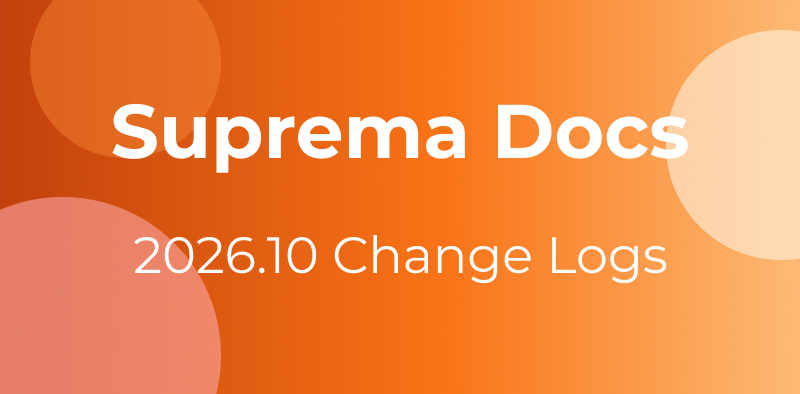
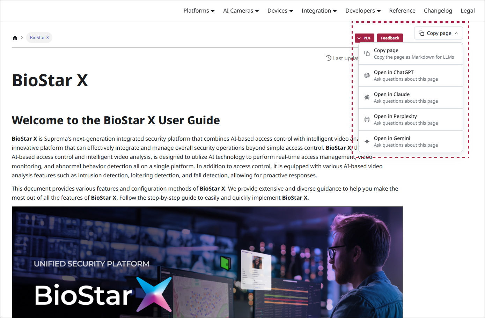

October brings plenty of news to **Suprema Docs**. In line with **ViOnyx** version 1.1.0, we've added guidance on access control, schedules, and RS-485 settings, and published the release notes. We've also newly published an integration guide for **BioStar X** and **Milestone XProtect**, and added recommended system architecture, card format settings, and private authentication mode settings to the **Genetec** integration guide. In addition, we've published release notes for **CoreStation 40** and **Device Manager**.

{/*truncate*/}

## Docs

* A **Copy page** button has been added to each individual document page. You can copy the document content in Markdown format or open it directly in an AI service to ask questions about the document.

  * **Copy page**: Copies the current document in Markdown format. You can paste the copied content into an AI service.

  * **Open in ChatGPT**, **Open in Claude**, **Open in Perplexity**, **Open in Gemini**: Opens the current document in the selected AI service so you can ask questions about its content.

  

## Platform

### BioStar X

* [Supported Devices](/platform/biostar_x/supported-device): Added device photos and minimum firmware versions

## Devices

### Device Updates

* [ViOnyx](/device/vionyx)

  * [Installation and Connection](/device/vionyx/installation): Added guidance on RS-485 connection

  * [Accessing and Configuring the Web Server](/device/vionyx/web-server-settings#access-web-server): Updated the procedure for accessing the camera web server and setting the password

* [ViOnyx Web Server](/device/vionyx_webserver/)

  * AI Events

    * [Set Up Access Control Events](/device/vionyx_webserver/configure-access-control): Added guidance on identifying people through face recognition and detecting tailgating

    * Added the **Person Detection** option to the following pages

      * [Set Up User Tracking Events](/device/vionyx_webserver/configure-people-tracking)

      * [Set Up Intrusion Detection Events](/device/vionyx_webserver/configure-intrusion)

      * [Set Up Line-Crossing Detection Event](/device/vionyx_webserver/configure-line-crossing)

      * [Set Up People Counting Event](/device/vionyx_webserver/configure-counting-people)

    * [AI Rule Settings](/device/vionyx_webserver/set-ai-rule#setRelayAction): Added user selection and relay action settings

    * [Manage Schedules](/device/vionyx_webserver/manage-schedule): Added guidance on setting the days and time periods when AI rules operate

  * Access Control

    * [Manage Access Control](/device/vionyx_webserver/manage-access-control): Added guidance on registering doors, granting access permissions to users, and controlling doors based on face recognition results

    * [Manage Doors](/device/vionyx_webserver/manage-doors), [Manage Access Levels](/device/vionyx_webserver/manage-access-levels): Added guidance on registering doors and managing doors, access times, and users together as access levels

    * [Control Doors](/device/vionyx_webserver/control-doors): Added guidance on checking door status in real time and remotely opening or locking doors

    * [Set Door Rules](/device/vionyx_webserver/configure-door-rules): Added guidance on playing audio, sending webhooks, and triggering relay actions based on access decisions

  * [View Live Video](/device/vionyx_webserver/live-basic): Added guidance on screen capture and AI display options

  * [Set Up RS-485](/device/vionyx_webserver/configure-rs485): Added guidance on adding and managing Suprema I/O devices as slave devices

  * [Configure Camera Settings](/device/vionyx_webserver/configure-camera-settings): Added automatic IR switching, adaptive auto exposure, and camera heater settings

  * [Configure Network Settings](/device/vionyx_webserver/configure-network): Added guidance on port, video streaming and encryption, ONVIF, and Tunnel settings

  * [Manage Operators](/device/vionyx_webserver/manage-operators): Added guidance on ONVIF-only accounts

  * [View System Logs](/device/vionyx_webserver/view-system-logs), [System Log Types](/device/vionyx_webserver/system-log-type): Added access control logs

* [BioStation 3 Max](/device/biostation_3_max)

  * [Settings](/device/biostation_3_max/settings): Added idle screen video playback and video volume settings

  * [User](/device/biostation_3_max/user#registering-user-information): Updated guidance on the special characters allowed in user IDs and names, and added the duress fingerprint setting

  * [Authentication](/device/biostation_3_max/authentication#operation): Updated guidance on fingerprint authentication support in server matching

* [XPass Q2](/device/xpass_q2)

  * [Getting Started](/device/xpass_q2/getting-started#how-to-scan-qrbarcode): Added the recommended scanning distance for QR codes and barcodes

  * [Product Specifications](/device/xpass_q2/product-specifications) updated

### Release Notes

* [ViOnyx](/device/vionyx/release-notes/110): Added release notes for version 1.1.0

* [CoreStation 40](/device/corestation_40/release-notes/174): Added release notes for version 1.7.4

* [Device Manager](/device/device_manager/release-notes/125): Added release notes for version 1.2.5

## Integrations

### New Integrations

We've newly published documentation on integrating **BioStar X** with **Milestone XProtect** through the MIPAccessControl plugin.

* [Milestone](/integration/milestone/)

  * [Introduction](/integration/milestone/introduction): Covers integration features, the system architecture, and the structural differences between BioStar X and XProtect

  * [Installation](/integration/milestone/installation): Covers prerequisites and how to install the Milestone x Suprema plugin

  * [Configuration](/integration/milestone/configuration): Covers plugin settings, license activation, and how to link cameras with access points

  * [Synchronization Check](/integration/milestone/synchronization): Covers how to check the synchronization of door status, cardholder information, and events

  * [Troubleshooting](/integration/milestone/troubleshooting): Covers solutions to common issues such as connection failures, missing events, and SSL certificate errors, along with frequently asked questions

### Integration Updates

* [Genetec](/integration/genetec/)

  * [Installation](/integration/genetec/installation#recommended-system-architecture): Added the recommended system architecture, recommended server specifications by number of devices, and system requirements

  * [System Management](/integration/genetec/system-management#card-format-setting): Added how to configure Wiegand card and smart card formats

  * [Cardholder Management](/integration/genetec/cardholder-management#private-authentication-mode): Added how to configure private authentication mode and issue AoC (Access on Card)
