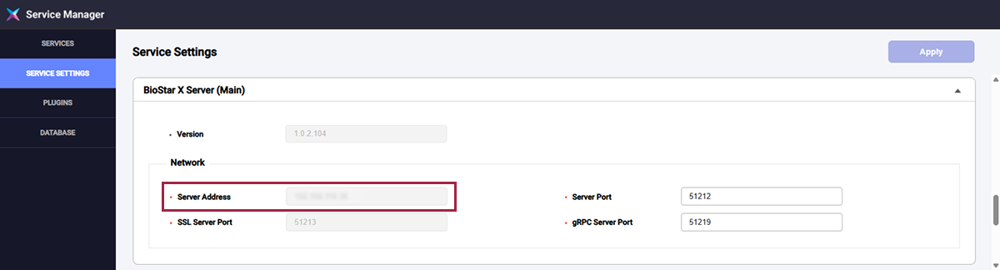

Use this document when the server's network environment changes or when you need to change the IP address after initial setup. Learn how to safely change the BioStar X main server IP address and reconfigure the connected Multi Communications Server.

:::info

The main server IP address change feature is supported in **BioStar X v1.0.2** or later.

:::

## Change IP address

First, change the IP address on the server where **BioStar X** is installed. Change the IP address of the network adapter connected to the external network.

:::info

For more information about changing the IP address on Windows, see [Microsoft Customer Support](https://support.microsoft.com/en-us/windows/essential-network-settings-and-tasks-in-windows-f21a9bbc-c582-55cd-35e0-73431160a1b9).

:::

## Apply the new IP address

Follow the steps below to change the IP address on the server where **BioStar X** is installed.

### BioStar X IP Setting

Use the **BioStar X IP Setting** tool to change the IP address.

1. In Windows, click <Start/> → **BioStar X** → **BioStar X IP Setting**.

2. When the <Cmd>BioStar X IP Setting</Cmd> window appears, select the IP address in <Cmd>Server Address</Cmd>.

   <Image src='/img/common/biostarx-sm-change-ip.png' alone />

3. Click <Cmd>Apply</Cmd>.

4. If a message about the IP address change appears, review it and click <Cmd>Yes</Cmd>.

   <Image src='/img/common/biostarx-sm-change-ip-warning-message.png' alone />

5. Wait until the IP address change process completes. When the process completes, a success message appears.

   <Image src='/img/common/biostarx-sm-change-ip-progress-status.png' alone />

6. If the **IP change applied successfully** message appears, click <Cmd>OK</Cmd>.

   <Image src='/img/common/biostarx-sm-change-ip-success.png' alone />

After the IP address change completes, all services restart.

:::info

* The IP address cannot be entered manually; select one from the IP addresses listed in <Cmd>Server Address</Cmd>.

* The new IP address appears in **BioStar X Service Manager** → <Cmd>SERVICE SETTINGS</Cmd> → <Cmd>BioStar X Server (Main)</Cmd> under <Cmd>Server Address</Cmd>.

   

* If a device is registered to BioStar X with the <Cmd sid='device.info.deviceToServerConnection' product='2' /> option, the administrator must manually update that device's server IP address to the new IP address.

:::

### Modify database server settings

If the database is hosted on the same server as **BioStar X**, stop all services, then edit **BioStar X**'s *system.conf* file. Skip this step if you are using an external database server.

1. Stop all services related to **BioStar X** in Windows Services (service.msc).

2. Navigate to *C:\Program Files\BioStar X Server*.

3. Open the *system.conf* file with a text editor such as Notepad.

4. In the `database` section, change the `server_ip` value to the new IP address.

5. Save and close the *system.conf* file.

6. Restart all services related to **BioStar X** in Windows Services (service.msc).

Open a web browser and verify that the server is accessible using the new IP address.

## Update Multi Communications Server {/* #communicationServer */}

If you installed an additional Multi Communications Server, update its settings to use the main server's new IP address. Follow this procedure on the server where you installed the Multi Communications Server.

1. Navigate to *C:\\Program Files\\BioStar X Communications Server*.

2. Run *biostar-device-cert-enroll.exe*.

3. When the <Cmd>Certificate Enrollment</Cmd> window appears, enter the new main server IP address in the <Cmd>Main Server IP Address</Cmd> field.

   <Image src='/img/common/biostarx-sm-change-ip-enroll-cert.png' alone />

4. If the main server port number differs from the default (21810), enter the new port number in the <Cmd>BioStar X Coordinator Service Port</Cmd> field.

5. Click <Cmd>Enroll</Cmd>.

When the main server IP address update completes, a success message appears.

<Image src='/img/common/biostarx-sm-change-ip-enroll-cert-success.png' alone />

:::info

* If you did not install a Multi Communications Server, skip this step.

* If you changed the port number on the main server where BioStar X is installed, run **BioStar X Service Manager** on the main server and check the <Cmd>Client Port</Cmd> value under <Cmd>SERVICE SETTINGS</Cmd> → <Cmd>BioStar X Coordinator Service</Cmd>.

  <Image src='/img/common/biostarx-sm-coordinator-s.png' alone />

* For more information about installing the Multi Communications Server, see <DocLink docId='platform/biostar_x/install-communication-server' />.

:::
