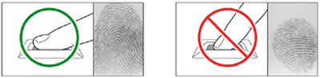

Enroll the user's fingerprint as an access credential. Enroll the user's fingerprint data on a device that supports fingerprint authentication. Fingerprints can be scanned on devices equipped with a fingerprint scanner.

:::note

**Before enrolling fingerprints...**

* Make sure the user's fingerprint is clean and dry.

* Don't enroll injured fingers or fingers with faint fingerprints.

:::

In the <Cmd sid='common.credential' product='2' /> section, click <Cmd sid='button.addFingerprint' product='2' />. When the <Cmd sid='user.header.fingerprint' product='2' /> window appears, configure each item and click <Cmd sid='button.enroll' product='2' />.

<Image src='/img/biostarx-new-user-credential-finger.png' />

* <Cmd sid='common.device' product='2' />: Select the device to enroll the fingerprint.

* <Cmd sid='common.quality' product='2' />: Set the fingerprint enrollment quality. You cannot enroll fingerprint data unless the quality meets the set level.

* <Cmd sid='user.viewImage' product='2' />: Shows the original image of the scanned fingerprint in area <Num num='1' />.

* <Cmd sid='button.addplus' product='2' />: Adds a fingerprint. You can enroll up to 10 fingerprints.

* <Cmd sid='button.scan' product='2' />: Starts scanning the selected fingerprint number. Place the finger on the fingerprint scanner or device sensor to scan the fingerprint.

  <Image src='/img/biostarx-new-user-credential-finger-nth.png' />

* <Cmd sid='button.delete' product='2' />: Deletes an enrolled fingerprint. Select the fingerprint number to delete, and then click Delete.

* <Cmd sid='button.chkDuplicated' product='2' />: Checks whether the fingerprint is already enrolled.

* <Cmd sid='user.duress' product='2' />: To enroll a fingerprint as a [duress fingerprint](../../reference/glossary#duress), select this option and scan the fingerprint. If someone threatens you or forces you to unlock the door, you can use that fingerprint to send a notification.

:::info

* Don't use the fingerprint you use for everyday access as a duress fingerprint.

* When you turn on the <Cmd sid='user.viewImage' product='2' /> option, the fingerprint image appears, but it is not stored on the **BioStar X** server.

* If the fingerprint authentication rate is low, delete the fingerprint data and enroll new fingerprint data.

* To get high-quality fingerprint data, place your finger so it covers the entire surface of the fingerprint recognition sensor. Enroll the fingerprint of the index or middle finger.

  

:::
