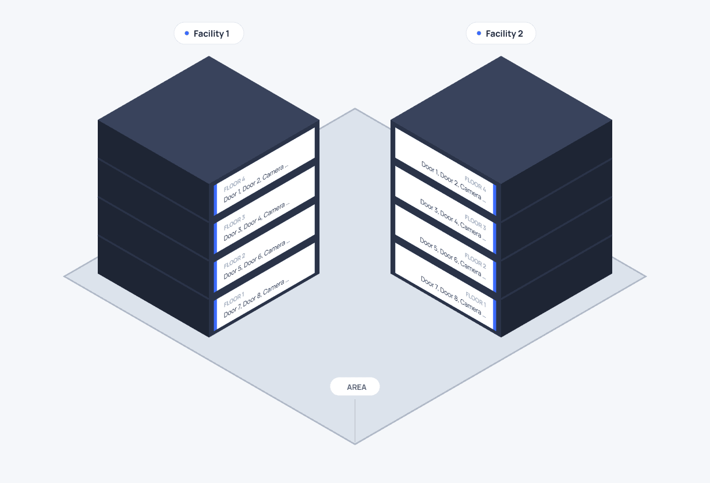

Learn how to monitor and control the real-time status of doors and cameras by area and by floor within each area using the map monitoring feature. Map Monitoring lets you easily navigate areas and floors in a visual interface integrated with Google Maps and use features such as door control and camera video playback.

To access the <Cmd sid='arena.title' /> page, click <Cmd sid='arena.title' /> in the <Cmd sid='shell.header.launcher' /> or select <Cmd sid='arena.title' /> from the menu in the upper-left corner of the screen.

In **BioStar X**, you can set up multiple facilities in a single area. Each facility can include multiple floors. On a floor, you can set up doors and cameras based on the floor plan and monitor them. See the image below.

Link the area configured as shown to a GIS map, and then go to Area → Facility → Floor on the map to monitor and control doors and cameras. This structure also appears in the sidebar on the <Cmd sid='arena.title' /> page.

:::info

* For more information about configuring the map, see <DocLink docId='platform/biostar_x/settings-map-management' />.

* The <Cmd sid='arena.title' /> area is disabled if the system has no registered camera devices or no registered map components (areas, facilities, floors).

* The GIS-integrated map monitoring feature is available as an add-on option with an **Essential** license or above. For more information about licensing policies, see <DocLink docId='platform/biostar_x/licensing#features-add-ons' />.

:::

## Components and optional features {/* #component-and-options */}

### Map tree components {/* #mapTreeComponent */}

The left sidebar shows the map tree components. The icon for each component in the map tree indicates whether it is an area, facility, floor, door, or camera.

<Columns>
<Column>

<Image src='/img/monitoring-map-area-tree-example.png' />

</Column>
<Column>

| Icon | Name |
| :-: | :-: |
| <IcArea width='35px' height='35px' /> | Area |
| <IcFacility width='35px' height='35px' /> | Facility |
| <IcFloor width='35px' height='35px' /> | Floor |
| <IcDoorClose width='35px' height='35px' /> | Door |
| <IcCamOk width='auto' height='35px'/> | Camera |

</Column>
</Columns>

### Map area components {/* #mapCmponent */}

Components displayed on the map include areas, facilities, and cameras connected to facilities. You can access floors through a facility. On a floor, you can see doors and cameras.

<Image src='/img/biostarx-monitoring-map-main.png' />

| Component | Description |
| :-: | --- |
|  | **Facility**: Click a facility placed on the map to enter the floors set up for that facility. |
|  | **Door**: Click on a door placed on the map to display a pop-up menu for controlling that door. For more information about the available features, see <DocLink docId='platform/biostar_x/control-door' />. |
|  | **Camera**: Click a camera to play video for the corresponding facility or floor. |
|  | **Camera error**: Appears when the camera is not connected or turned off. |
| <IcFUlockDr width='45' height='45' /> | **Unlocked door**: The door placed on the floor is unlocked. |
| <IcFLockDr width='45' height='45' /> | **Locked door**: The door placed on the floor is locked. |

### Optional features {/* #options */}

The options available on the map or floor are listed below.

| Feature | Description |
| :-: | --- |
|  /  | Click the buttons in the upper-left and lower-right corners of the map to zoom in or out. Alternatively, use the mouse wheel to zoom in or out on the map. |
| <IcZoom /> | Click the buttons in the lower-right corner of the floor to zoom in or out. |
| <IcMapmore width='30' height='30' /> | Click the button to use additional features. |
| <IcClose width='30' height='30'/> | To close the map or floor in the video tile, click the button in the upper-right corner of the video tile. |
| <IcMove width='30' height='30'/> | Click and drag the icon to move the map to another location. |

:::info

* Click and drag on the map to move to a different location. Use the mouse wheel to zoom in or out.

* Double-click the map to expand it to full screen. Double-click again or press <Kbd>ESC</Kbd> to return to the original size.

:::

### Check the status

In the left sidebar, you can check the status of each door and camera for the facilities or floors. For the status of each icon, see below.

| Status Icon | Description |
| :-: | --- |
| <IcErr width='35px' height='35px' /> | A Multi Communications Server error occurred, or the connection is lost. |
| <IcAlert width='40px' height='40px' /> | An alarm has occurred at the door. If loitering or intrusion is detected, the corresponding icon appears. |
| <IcCamOk width='auto' height='35px'/> | The camera is connected. |
| <IcCamFail width='auto' height='35px'/> | The camera is off or disconnected. |

### View entries that need attention {/* #checkAttentionFilter */}

Administrators can view only entries that require action in one place. Click the <Cmd sid='arena.tree.door.entitiesNeedAttention' /> in the left sidebar. You can check the status of doors assigned to the area, facility, and floor hierarchy, and take action on doors with issues.

<Image src='/img/monitoring-map-tree-attention-filter.png' />

:::info

For the criteria for determining which doors require action, see <DocLink docId='platform/biostar_x/check-door-status#check-the-attention-criteria' />.

:::

## Open the map {/* #open-map */}

If the area is linked to the GIS map, the <Cmd sid='arena.title' /> section shows the map.

1. In the left sidebar, select the facility to view on the map.

2. Right-click. 

3. Click <Cmd sid='arena.tree.contextMenu.openMap' /> in the pop-up menu.

The map of the selected area appears in the video tile of the <Cmd sid='arena.title' /> section.

<Image src='/img/monitoring-map-open-map.png' alt='Open the map' />

:::info

* Double-click the facility in the left sidebar to open the map where the facility is located.

* The image is an example screen. The actual screen may differ.

* For more information about configuring areas linked to the GIS map, see <DocLink docId='platform/biostar_x/settings-map-manage-area' />.

:::

## Resize and move the map {/* #resize-map */}

To resize the map, click an empty area on the map. Resize handles appear at each corner. Click and drag a handle to resize the map.

<Image src='/img/common/biostarx-monitoring-map-resize.gif' alone />

To move the map after resizing, click and drag the <IcMove /> icon on the map to another location.

<Image src='/img/common/biostarx-monitoring-map-move.gif' alone />

## Enter a floor {/* #entry-floor */}

To enter a floor from the map, click a facility. When the list of floors accessible from the pop-up menu is displayed, select the desired floor. You can view the floor plan, doors, and cameras for the selected floor.

Or, double-click the floor in the left sidebar or right-click it and select <Cmd sid='arena.tree.contextMenu.openMap' /> from the pop-up menu.

<Image src='/img/monitoring-map-select-floor.png' />

| Component | Description |
| :-: | --- |
| <IcFUlockDr width='45' height='45' /> | **Unlocked door**: The door placed on the floor is unlocked. |
| <IcFLockDr width='45' height='45' /> | **Locked door**: The door placed on the floor is locked. |
| <IcFloorCam width='45' height='45' /> | **Camera**: Click a camera to play video for the corresponding facility or floor. |

* Hover over a door or camera to check its current status.

  <Image src='/img/monitoring-map-floor-status-check.png' className='none' />

* Clicking the door will display a pop-up menu that allows you to control that door. For more information about the available features, see <DocLink docId='platform/biostar_x/control-door' />.

  <Image src='/img/monitoring-map-floor-control-door.png' />

* Double-click a camera to play live video.

  <Image src='/img/common/monitoring-map-select-floor-play-video.png' alone />

:::info

* To go to the map that shows the facility, click <IcBack/> in the upper-left corner of the screen.

* For more information about setting up doors and cameras on a floor (Floor), see <DocLink docId='platform/biostar_x/settings-map-manage-floor' />.

* For more information about video controls and the tools displayed in the video, see <DocLink docId='platform/biostar_x/monitoring-video#control-video' />.

* The image is an example screen. The actual screen may differ.

:::

## Move to another floor {/* #move-to-another-floor */}

To move to a different floor, click the floor selection option in the upper-left corner of the map, and select a floor from the list.

<Image src='/img/common/monitoring-map-select-floor-list-box.png' alone />

:::info

* To go to the map that shows the facility, click <IcBack/> in the upper-left corner of the screen.

* The floor selection option in the upper-left corner of the map shows only the floors set up for the facility. If the floor is not set up for the facility, it does not appear in the list. For more information about configuring floors within a facility, see <DocLink docId='platform/biostar_x/settings-map-manage-facility' />.

:::

## Control a camera {/* #control-camera */}

* To control a camera on the map or floor, click a camera. Select a feature from the pop-up menu.

  <Image src='/img/biostarx-monitoring-map-camera-popup.png' className='none' />

  * <Cmd sid='map.menu.camera.playVideo' />: Shows the camera video in real time.

  * <Cmd sid='map.menu.camera.showCoverage' /> / <Cmd sid='map.menu.camera.hideCoverage' />: Shows or hides the camera coverage area.

  * <Cmd sid='map.menu.door.viewDetail' />: Shows detailed information about the camera. Shows the camera name, group, ID, IP address, and other details in the right pane.

* To place and play the camera feed on the video tile, double-click the camera in the <Cmd sid='arena.map.title' /> list in the left sidebar. Or right-click and select <Cmd sid='arena.tree.contextMenu.openVideo' /> from the pop-up menu.

  <Image src='/img/biostarx-monitoring-map-open-camera.png' />

  To view detailed information such as the camera's name and group, click <Cmd sid='arena.tree.contextMenu.viewDetail' /> from the pop-up menu.

:::info

* Videos are added to the video tiles in order, starting in the upper-left corner of the screen; if the current screen has no space, an error message appears.

* For more information about video controls and the tools displayed in the video, see <DocLink docId='platform/biostar_x/monitoring-video#control-video' />.

* If a camera is not visible on the map, check the camera group permissions. If an administrator with custom permissions has not set camera group permissions, cameras might not appear. For more information about setting camera group permissions, see <DocLink docId='platform/biostar_x/settings-videos-camera#addCameraPermission' />.

:::
