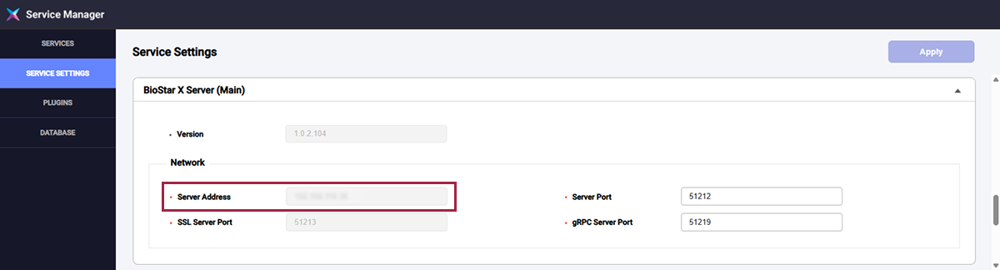

Use este documento cuando cambie el entorno de red del servidor o cuando necesite cambiar la dirección IP después de la configuración inicial. Aprenda cómo cambiar de forma segura la dirección IP del servidor principal de BioStar X y reconfigurar el Multi Communications Server conectado.

:::info

La función de cambio de dirección IP del servidor principal es compatible con **BioStar X v1.0.2** o versiones posteriores.

:::

## Cambiar dirección IP

Primero, cambia la dirección IP en el servidor donde está instalado **BioStar X**. Cambia la dirección IP del adaptador de red conectado a la red externa.

:::info

Para obtener más información sobre cómo cambiar la dirección IP en Windows, consulta [Microsoft Customer Support](https://support.microsoft.com/en-us/windows/essential-network-settings-and-tasks-in-windows-f21a9bbc-c582-55cd-35e0-73431160a1b9).

:::

## Aplicar la nueva dirección IP

Sigue los pasos siguientes para cambiar la dirección IP en el servidor donde está instalado **BioStar X**.

### BioStar X IP Setting

Use la herramienta **BioStar X IP Setting** para cambiar la dirección IP.

1. En Windows, haz clic en <Start/> → **BioStar X** → **BioStar X IP Setting**.

2. Cuando aparezca la ventana <Cmd>BioStar X IP Setting</Cmd>, seleccione la dirección IP en <Cmd>Server Address</Cmd>.

   <Image src='/img/common/biostarx-sm-change-ip.png' alone />

3. Haga clic en <Cmd>Apply</Cmd>.

4. Si aparece un mensaje sobre el cambio de dirección IP, revíselo y haga clic en <Cmd>Yes</Cmd>.

   <Image src='/img/common/biostarx-sm-change-ip-warning-message.png' alone />

5. Espera hasta que finalice el proceso de cambio de dirección IP. Cuando se complete el proceso, aparecerá un mensaje de éxito.

   <Image src='/img/common/biostarx-sm-change-ip-progress-status.png' alone />

6. Si aparece el mensaje **IP change applied successfully**, haga clic en <Cmd>OK</Cmd>.

   <Image src='/img/common/biostarx-sm-change-ip-success.png' alone />

Después de que se complete el cambio de dirección IP, todos los servicios se reinician.

:::info

* La dirección IP no se puede introducir manualmente; selecciona una de las direcciones IP que figuran en <Cmd>Server Address</Cmd>.

* La nueva dirección IP aparece en **BioStar X Service Manager** → <Cmd>SERVICE SETTINGS</Cmd> → <Cmd>BioStar X Server (Main)</Cmd>, en <Cmd>Server Address</Cmd>.

   

* Si un dispositivo está registrado en BioStar X con la opción <Cmd sid='device.info.deviceToServerConnection' product='2' />, el administrador debe actualizar manualmente la dirección IP del servidor de ese dispositivo a la nueva dirección IP.

:::

### Modificar la configuración del servidor de base de datos

Si la base de datos está alojada en el mismo servidor que **BioStar X**, detenga todos los servicios y luego edite el archivo *system.conf* de **BioStar X**. Omita este paso si usa un servidor de base de datos externo.

1. Detenga todos los servicios relacionados con **BioStar X** en Servicios de Windows (service.msc).

2. Vaya a *C:\\Program Files\\BioStar X Server*.

3. Abra el archivo *system.conf* con un editor de texto como Notepad.

4. En la sección `database`, cambie el valor `server_ip` a la nueva dirección IP.

5. Guarde y cierre el archivo *system.conf*.

6. Reinicie todos los servicios relacionados con **BioStar X** en Servicios de Windows (service.msc).

Abra un navegador web y verifique que pueda acceder al servidor con la nueva dirección IP.

## Actualizar Servidor de Multi Comunicaciones {/* #communicationServer */}

Si instaló un Multi Communications Server adicional, actualice su configuración para que use la nueva dirección IP del servidor principal. Siga este procedimiento en el servidor donde instaló el Multi Communications Server.

1. Vaya a *C:\\Program Files\\BioStar X Communications Server*.

2. Ejecuta *biostar-device-cert-enroll.exe*.

3. Cuando aparezca la ventana <Cmd>Certificate Enrollment</Cmd>, introduzca la nueva dirección IP del servidor principal en el campo <Cmd>Main Server IP Address</Cmd>.

   <Image src='/img/common/biostarx-sm-change-ip-enroll-cert.png' alone />

4. Si el número de puerto del servidor principal es distinto del predeterminado (21810), introduzca el nuevo número de puerto en el campo <Cmd>BioStar X Coordinator Service Port</Cmd>.

5. Haga clic en <Cmd>Enroll</Cmd>.

Cuando se complete la actualización de la dirección IP del servidor principal, aparecerá un mensaje de éxito.

<Image src='/img/common/biostarx-sm-change-ip-enroll-cert-success.png' alone />

:::info

* Si no instaló un Multi Communications Server, omita este paso.

* Si cambió el número de puerto en el servidor principal donde está instalado BioStar X, ejecute **BioStar X Service Manager** y verifique el valor <Cmd>Client Port</Cmd> en <Cmd>SERVICE SETTINGS</Cmd> → <Cmd>BioStar X Coordinator Service</Cmd>.

  <Image src='/img/common/biostarx-sm-coordinator-s.png' alone />

* Para obtener más información sobre la instalación de Multi Communications Server, consulta <DocLink docId='platform/biostar_x/install-communication-server' />.

:::
