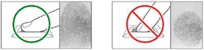

Inscriba la huella digital del usuario como credencial de acceso. Inscriba los datos de la huella digital del usuario en un dispositivo compatible con autenticación por huella digital. Las huellas digitales se pueden escanear en dispositivos equipados con un lector de huellas digitales.

:::note

**Antes de inscribir huellas digitales...**

* Asegúrese de que la huella digital del usuario esté limpia y seca.

* No inscriba dedos lesionados ni dedos con huellas poco marcadas.

:::

En la sección <Cmd sid='common.credential' product='2' />, haga clic en <Cmd sid='button.addFingerprint' product='2' />. Cuando aparezca la ventana <Cmd sid='user.header.fingerprint' product='2' />, configure cada elemento y haga clic en <Cmd sid='button.enroll' product='2' />.

<Image src='/img/biostarx-new-user-credential-finger.png' />

* <Cmd sid='common.device' product='2' />: Seleccione el dispositivo para inscribir la huella digital.

* <Cmd sid='common.quality' product='2' />: Configure la calidad de inscripción de la huella digital. No puede inscribir los datos de la huella digital a menos que la calidad cumpla con el nivel establecido.

* <Cmd sid='user.viewImage' product='2' />: Muestra la imagen original de la huella digital escaneada en el área <Num num='1' />.

* <Cmd sid='button.addplus' product='2' />: Agrega una huella digital. Puede inscribir hasta 10 huellas digitales.

* <Cmd sid='button.scan' product='2' />: Inicia el escaneo del número de huella digital seleccionado. Coloque el dedo en el lector de huellas digitales o en el sensor del dispositivo para escanear la huella digital.

  <Image src='/img/biostarx-new-user-credential-finger-nth.png' />

* <Cmd sid='button.delete' product='2' />: Elimina una huella digital inscrita. Seleccione el número de huella digital que desea eliminar y luego haga clic en Eliminar.

* <Cmd sid='button.chkDuplicated' product='2' />: Verifica si la huella digital ya está inscrita.

* <Cmd sid='user.duress' product='2' />: Para inscribir una huella digital como [huella digital de coacción](../../reference/glossary#duress), seleccione esta opción y escanee la huella. Si alguien lo amenaza o lo obliga a desbloquear la puerta, puede usar esa huella digital para enviar una notificación.

:::info

* No use la huella digital que utiliza para el acceso diario como huella de coacción.

* Cuando active la opción <Cmd sid='user.viewImage' product='2' />, aparecerá la imagen de la huella digital, pero no se almacena en el servidor de **BioStar X**.

* Si la tasa de autenticación por huella digital es baja, elimine los datos de la huella digital e inscriba nuevos datos de huella digital.

* Para obtener datos de huella digital de alta calidad, coloque el dedo de modo que cubra toda la superficie del sensor de reconocimiento de huellas digitales. Inscriba la huella digital del dedo índice o medio.

  

:::
